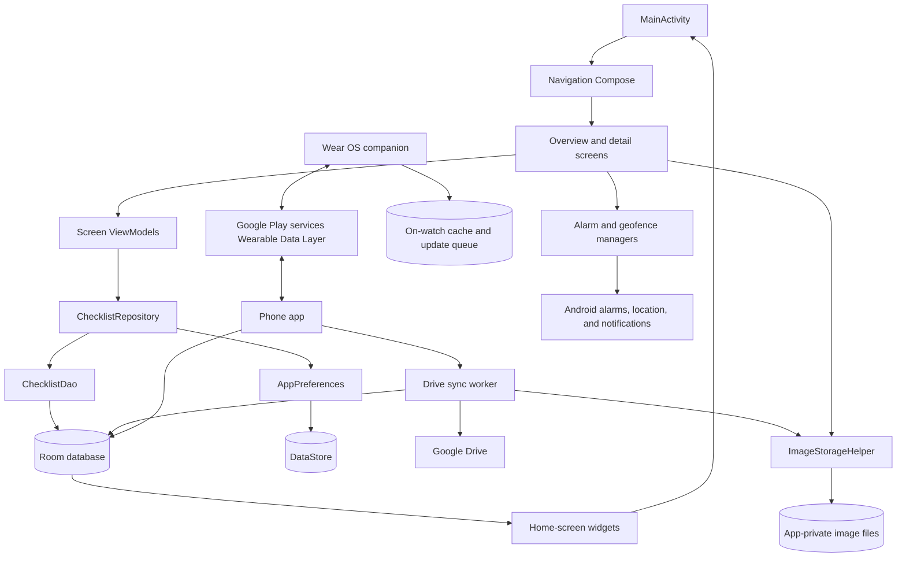

# Tickfolio

Tickfolio is an Android checklist app for keeping useful lists close to the
contexts where they matter. Make a packing list before a trip, a maintenance
checklist for a car, or a room-by-room list for cleaning at home. Its paper-
inspired interface keeps everyday tasks simple while letting each checklist
carry the details that make it useful.

## What you can do

- Create and manage checklists with a title, description, and themed icon.
- Add checklist items with descriptions, tags, completion state, and a photo
  from the camera or gallery.
- Set an optional due date and time for each item and receive a notification
  when it is due. Notifications are scheduled locally and only sent for
  incomplete items; Android notification permission is requested when needed.
- Search checklists and filter checklist items by text, tag, or completion.
- Sort checklists by title, due date, last edit, creation date, or last opened
  time in either ascending or descending order; the chosen sort is remembered.
- Long-press a checklist in the overview to select multiple checklists for deletion.
- Set date-and-time reminders or location-proximity reminders.
- Automatically reset checklist items daily, weekly, or monthly, with a chosen
  reset time and (for weekly/monthly schedules) weekday or day of the month.
- Optionally back up and sync checklists, completion progress, and photos with
  Google Drive. Sync is off until enabled and authorized by the user.
- Choose a geofence location on an interactive map, search for a place, or use
  the device's current location.
- Add a home-screen widget for one checklist with tappable completion controls,
  or a separate scrollable widget for opening any saved checklist.
- Browse checklists and update item progress from the Wear OS companion app,
  including while offline; queued progress syncs with the phone when connected.
- Choose whether the app opens to all checklists or the latest checklist, and
  select system, light paper, or dark parchment appearance.
- On Android 13 and later, change the app language in system settings under
  **Settings > Apps > Tickfolio > Language** (English or Italian).
- Load sample checklists from the overview's sample-data action, including the
  original trip, car maintenance, and cleaning examples plus eight unchecked
  templates: Weekend Trip, Weekly Home Reset, Grocery Run, Car Trip Preparation,
  Productive Workday, Moving Home, Laundry Day, and Hosting Friends. Templates
  include tags, multi-check items in the Laundry Day and Hosting Friends
  templates, and no preset reminders.

Tickfolio is local-first: checklist data and item photos are stored on the
device. Google Drive backup is optional and requires the user's consent;
without it, data remains on the device. Map tiles are loaded from OpenStreetMap
and therefore require an internet connection.

## Architecture

The app uses Jetpack Compose for its UI, Navigation Compose for screen
navigation, and a lightweight MVVM structure. UI state is exposed from
ViewModels as `StateFlow`; composables observe it and send user actions back to
the ViewModels.



- **Application setup:** `ChecklistApplication` creates the Room database,
  preferences store, repository, and geofence manager, and schedules enabled
  Drive syncs.
- **Data:** Room stores checklist and item records; `ChecklistDao` provides
  observable queries and mutations. `ChecklistRepository` coordinates database
  operations and preferences. DataStore holds the selected launch page, theme,
  latest-opened checklist, and optional Drive backup settings.
- **UI:** `OverviewScreen` and `ChecklistDetailScreen` are backed by their own
  ViewModels. Reusable Compose components live under `ui/components`, with
  light/dark previews for key UI and the checklist icons.
- **Reminders and photos:** `ChecklistAlarmReceiver` handles scheduled
  notifications. `GeofenceManager` registers location boundaries with Google
  Play services and `GeofenceBroadcastReceiver` displays proximity
  notifications, including when the app is closed (this requires the "Allow all
  the time" location permission, which the reminder dialog requests).
  `GeofenceRestoreReceiver` re-registers geofences after reboot or app update,
  and they are also restored on app launch. WorkManager periodically processes
  due recurring resets, including schedules missed while the device was off;
  checklist reset and next-run updates are committed atomically. Item images
  are copied to app-private storage. WorkManager schedules one-time due-date
  notifications for incomplete items and restores them from the database on
  app startup. When enabled, WorkManager also syncs data
  with Google Drive over a network connection after local edits and periodically.
  A ZIP backup contains checklist and item data, due dates, deletion records,
  and photos.
  Records are merged by stable sync ID, with the most recently edited version
  winning; deleted records are tracked to prevent older device copies from
  restoring them.
- **Map picker:** The location picker draws OpenStreetMap tiles and supports
  map gestures, place search, and selecting a location.
- **Home-screen widgets:** Glance renders a configurable single-checklist
  widget with direct item completion and an all-checklists widget. Room
  invalidations refresh both widgets when checklist data changes.
- **Wear OS companion:** The separate `:wear` application module caches
  checklist snapshots on the watch and lets users advance or reset item
  completion counts. The watch cannot create or edit checklist content.
  Progress updates are stored locally and sent as durable Wearable Data Items;
  the phone applies only updates newer than its current item version and sends
  refreshed snapshots back to the watch. Both APKs share the same application
  ID and must use the same signing certificate for the Data Layer to connect.

Add either widget from the launcher's widget picker. The single-checklist
widget prompts you to choose which saved checklist to show; tap a checklist
item to toggle its completion, or tap the header to open it in the app. The
all-checklists widget shows a scrollable list; tap a row to open that checklist.

The Room database has preserving migrations for schema versions 1 through 5.
Destructive fallback migration remains enabled for unsupported schema upgrades.

## Google Drive backup setup

Google Drive backup is optional. On first launch, Tickfolio asks whether to
enable it; the setting can also be changed later in the overview's Settings
dialog. When enabled, Tickfolio stores a `tickfolio_backup.zip` file inside an
app-managed folder directly under **My Drive**. The folder name defaults to
`Tickfolio` and can be changed in Settings. Checklist photos are included.
Tickfolio requests the narrow `drive.file` permission and only reads or
updates the folder and backup it creates. Disabling backup stops future syncs
but leaves the existing Drive backup intact.

To enable Drive access for a build, configure a Google Cloud project, enable
the Google Drive API, configure its OAuth consent screen, and add an Android
OAuth client matching the app's `applicationId` and the SHA-1 signing
certificate used for that build. For a locally installed debug build, this is
the debug signing certificate; distributed builds need a client matching their
signing certificate. Run `.\gradlew.bat signingReport` to see the local
certificate fingerprints. Without this setup, authorization and backup cannot
complete.

The archive is stored as a ZIP in the user's Drive account; Tickfolio does not
apply additional client-side encryption. Keep access to the Google account
secure.

## Nightly releases

The `.github/workflows/nightly-release.yml` workflow runs on `master` daily at
6:00 AM Europe/Rome time and can also be started manually from the GitHub
Actions tab. It builds a release APK and publishes it as a GitHub prerelease
when there are changes since the previous nightly. The APK is unsigned.

## Project structure

```text
.
├── .github/
│   └── workflows/
│       └── nightly-release.yml         # Scheduled Android nightly release
├── app/
│   ├── build.gradle.kts                # Android app configuration and dependencies
│   └── src/
│       ├── main/
│       │   ├── AndroidManifest.xml
│       │   ├── java/com/fexed/checklist/
│       │   │   ├── ChecklistApplication.kt
│       │   │   ├── MainActivity.kt
│       │   │   ├── data/
│       │   │   │   ├── local/          # Room database and DAO
│       │   │   │   ├── model/          # Checklist and checklist-item entities
│       │   │   │   ├── preferences/    # DataStore settings
│       │   │   │   ├── reminder/       # Alarm and geofence notifications
│   │   │   │   ├── repository/     # Data access boundary
│   │   │   │   └── sync/           # Drive backup, merge, and worker
│       │   │   ├── widget/             # Glance widgets and checklist picker
│       │   │   ├── ui/
│       │   │   │   ├── components/     # Reusable Compose UI and previews
│       │   │   │   ├── navigation/
│       │   │   │   ├── screens/        # Overview, detail, and settings
│       │   │   │   └── theme/          # Paper and parchment color schemes
│       │   │   └── util/               # Image storage and sample data
│       │   └── res/
│       │       ├── drawable/           # Adaptive launcher icon artwork
│       │       ├── mipmap-*/           # Launcher icons at device densities
│       │       ├── values/             # Strings, colors, and themes
│       │       └── xml/                # Widget and backup metadata
│       └── test/                       # Local JVM unit tests
├── gradle/
│   ├── libs.versions.toml              # Central dependency versions
│   └── wrapper/                        # Gradle wrapper configuration
├── build.gradle.kts                    # Root Gradle plugin configuration
├── settings.gradle.kts
└── gradlew / gradlew.bat               # Gradle wrapper scripts
```

## Build and test

Requirements:

- Android SDK Platform 37 (the configured compile SDK).
- JDK 25 for the Gradle daemon toolchain; Kotlin/Java compilation targets Java
  17.
- Android SDK Platform 26 or newer to run the app.

Use the Gradle wrapper from the project root:

```shell
# Windows
.\gradlew.bat assembleDebug
.\gradlew.bat testDebugUnitTest

# macOS / Linux
./gradlew assembleDebug
./gradlew testDebugUnitTest
```

The debug APK is written to
`app/build/outputs/apk/debug/app-debug.apk`.
