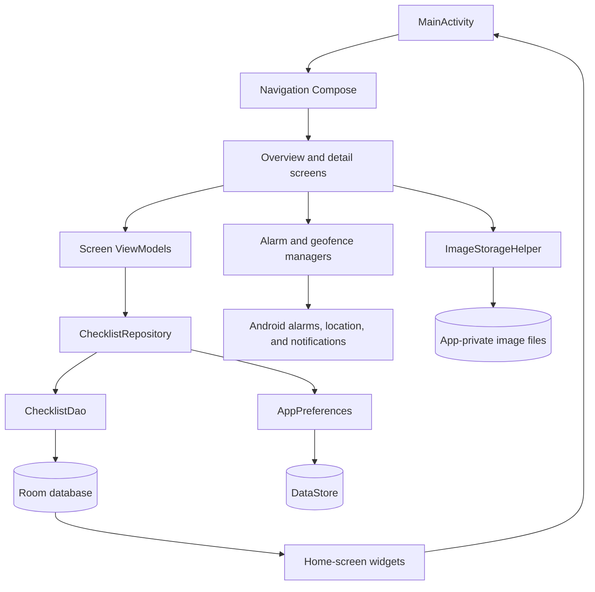

# Tickfolio

Tickfolio is an Android checklist app for keeping useful lists close to the
contexts where they matter. Make a packing list before a trip, a maintenance
checklist for a car, or a room-by-room list for cleaning at home. Its paper-
inspired interface keeps everyday tasks simple while letting each checklist
carry the details that make it useful.

## What you can do

- Create and manage checklists with a title, description, and themed icon.
- Add checklist items with descriptions, tags, completion state, and a photo
  from the camera or gallery.
- Search checklists and filter checklist items by text, tag, or completion.
- Set date-and-time reminders or location-proximity reminders.
- Choose a geofence location on an interactive map, search for a place, or use
  the device's current location.
- Add a home-screen widget for one checklist with tappable completion controls,
  or a separate scrollable widget for opening any saved checklist.
- Choose whether the app opens to all checklists or the latest checklist, and
  select system, light paper, or dark parchment appearance.
- Start with sample checklists, which are added automatically on first launch
  when the local database is empty.

Tickfolio is local-first: checklist data and item photos are stored on the
device. There is no account or cloud-sync service. Map tiles are loaded from
OpenStreetMap and therefore require an internet connection.

## Architecture

The app uses Jetpack Compose for its UI, Navigation Compose for screen
navigation, and a lightweight MVVM structure. UI state is exposed from
ViewModels as `StateFlow`; composables observe it and send user actions back to
the ViewModels.



- **Application setup:** `ChecklistApplication` creates the Room database,
  preferences store, repository, and geofence manager, and seeds sample data
  when the database is empty.
- **Data:** Room stores checklist and item records; `ChecklistDao` provides
  observable queries and mutations. `ChecklistRepository` coordinates database
  operations and preferences. DataStore holds the selected launch page, theme,
  and latest-opened checklist.
- **UI:** `OverviewScreen` and `ChecklistDetailScreen` are backed by their own
  ViewModels. Reusable Compose components live under `ui/components`, with
  light/dark previews for key UI and the checklist icons.
- **Reminders and photos:** `ChecklistAlarmReceiver` handles scheduled
  notifications. `GeofenceManager` registers location boundaries with Google
  Play services and `GeofenceBroadcastReceiver` displays proximity
  notifications. Item images are copied to app-private storage.
- **Map picker:** The location picker draws OpenStreetMap tiles and supports
  map gestures, place search, and selecting a location.
- **Home-screen widgets:** Glance renders a configurable single-checklist
  widget with direct item completion and an all-checklists widget. Room
  invalidations refresh both widgets when checklist data changes.

Add either widget from the launcher's widget picker. The single-checklist
widget prompts you to choose which saved checklist to show; tap a checklist
item to toggle its completion, or tap the header to open it in the app. The
all-checklists widget shows a scrollable list; tap a row to open that checklist.

The Room database currently uses destructive fallback migration. During this
MVP stage, a database schema upgrade without a migration can erase existing
local checklist data.

## Nightly releases

The `.github/workflows/nightly-release.yml` workflow runs on `master` daily at
6:00 AM Europe/Rome time and can also be started manually from the GitHub
Actions tab. It builds a release APK and publishes it as a GitHub prerelease
when there are changes since the previous nightly. The APK is unsigned.

## Project structure

```text
.
├── .github/
│   └── workflows/
│       └── nightly-release.yml         # Scheduled Android nightly release
├── app/
│   ├── build.gradle.kts                # Android app configuration and dependencies
│   └── src/
│       ├── main/
│       │   ├── AndroidManifest.xml
│       │   ├── java/com/fexed/checklist/
│       │   │   ├── ChecklistApplication.kt
│       │   │   ├── MainActivity.kt
│       │   │   ├── data/
│       │   │   │   ├── local/          # Room database and DAO
│       │   │   │   ├── model/          # Checklist and checklist-item entities
│       │   │   │   ├── preferences/    # DataStore settings
│       │   │   │   ├── reminder/       # Alarm and geofence notifications
│       │   │   │   └── repository/     # Data access boundary
│       │   │   ├── widget/             # Glance widgets and checklist picker
│       │   │   ├── ui/
│       │   │   │   ├── components/     # Reusable Compose UI and previews
│       │   │   │   ├── navigation/
│       │   │   │   ├── screens/        # Overview, detail, and settings
│       │   │   │   └── theme/          # Paper and parchment color schemes
│       │   │   └── util/               # Image storage and sample data
│       │   └── res/
│       │       ├── drawable/           # Adaptive launcher icon artwork
│       │       ├── mipmap-*/           # Launcher icons at device densities
│       │       ├── values/             # Strings, colors, and themes
│       │       └── xml/                # Widget and backup metadata
│       └── test/                       # Local JVM unit tests
├── gradle/
│   ├── libs.versions.toml              # Central dependency versions
│   └── wrapper/                        # Gradle wrapper configuration
├── build.gradle.kts                    # Root Gradle plugin configuration
├── settings.gradle.kts
└── gradlew / gradlew.bat               # Gradle wrapper scripts
```

## Build and test

Requirements:

- Android SDK Platform 37 (the configured compile SDK).
- JDK 25 for the Gradle daemon toolchain; Kotlin/Java compilation targets Java
  17.
- Android SDK Platform 26 or newer to run the app.

Use the Gradle wrapper from the project root:

```shell
# Windows
.\gradlew.bat assembleDebug
.\gradlew.bat testDebugUnitTest

# macOS / Linux
./gradlew assembleDebug
./gradlew testDebugUnitTest
```

The debug APK is written to
`app/build/outputs/apk/debug/app-debug.apk`.
